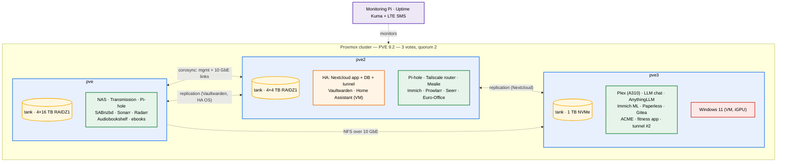

# Proxmox VE 9 — Homelab Infrastructure Documentation

> **🌐 PUBLIC / SANITISED VERSION**
> IP addresses, MAC addresses, domains, account names and identifiers are replaced with placeholders (`example.com`, RFC 1918 documentation-style addressing). No secrets appear in this document. Substitute your own values throughout.

| | |
|---|---|
| **Maintainer** | Richard Carragher (RC COMMS) |
| **Last updated** | 11 October 2026 |
| **Document version** | 3.0 (supersedes v1.2 / v2.x) |
| **Proxmox VE version** | 9.2 on all nodes · ZFS 2.4 |
| **Cluster** | Three nodes |
| **Classification** | Public |

### Addressing convention used in this document

| Placeholder | Meaning |
|---|---|
| `10.0.0.0/24` | Management / services LAN (1 GbE) |
| `10.0.1.0/24` | Storage fabric (10 GbE, MTU 9000, non-routed) |
| `10.0.0.30` / `.20` / `.25` | Nodes `pve` / `pve2` / `pve3` |
| `cloud.example.com`, `office.example.com`, `photos.example.com`, `vault.example.com` | Public hostnames (via Cloudflare Tunnel) |

Guest IDs and hostnames are real (they carry no sensitive information). Hostnames follow an Irish-mountains naming scheme.

---

## Related documents

- **`nextcloud-PUBLIC.md`** — Nextcloud on Proxmox LXCs: HA build, tunnel, migration from a VM appliance.
- **`eurooffice-nextcloud-PUBLIC.md`** — Euro-Office DocumentServer integration.
- **`self-hosted-private-cloud-runbook.md`** — generic family private-cloud reference build.

## Table of contents

1. [Overview](#1-overview)
2. [Architecture](#2-architecture)
3. [Storage and data protection](#3-storage-and-data-protection)
4. [Compute inventory](#4-compute-inventory)
5. [Networking](#5-networking)
6. [SMB / NFS layer](#6-smb--nfs-layer)
7. [Security and remote access](#7-security-and-remote-access)
8. [Operational runbook](#8-operational-runbook)
9. [Change log](#9-change-log)
10. [Explain like I'm 5](#10-explain-like-im-5)
11. [References](#11-references)
12. [Appendices](#12-appendices)

---

## 1. Overview

A three-node Proxmox VE 9 cluster runs around 30 LXC containers and two KVM VMs for a family homelab. Services include file sharing (SMB/NFS), a private cloud (Nextcloud + Euro-Office), photo backup (Immich), Plex with GPU transcode, Usenet automation, DNS ad-blocking (Pi-hole), Home Assistant, a password manager (Vaultwarden), ebooks and audiobooks, Paperless, Gitea, and a hybrid local-LLM stack. A Raspberry Pi outside the cluster runs Uptime Kuma with LTE SMS alerting.

**Design principles:** publish via **Cloudflare Tunnel** (no router port-forwards); administer via **Tailscale + LAN** only; **unprivileged LXCs**, one service per container; **ZFS** everywhere; HA only where it earns its keep; backups in three layers (local snapshots, cross-node replicas, encrypted off-site).

### Why LXC over VMs?

Containers share the host kernel: lighter, faster, and replicable as ZFS datasets. VMs are kept only where a separate kernel or OS image is required — Home Assistant OS and Windows 11. The last appliance VM (a TurnKey Nextcloud) was replaced by containers in October 2026.

### Node roles

| Node | Hardware | Role |
|---|---|---|
| `pve` | HPE MicroServer Gen10, 32 GB, 4×16 TB RAIDZ1 | Bulk storage + NFS exporter; NAS, media acquisition, Pi-hole primary, ebook/audiobook stacks |
| `pve2` | HPE MicroServer Gen10, 32 GB, 4×4 TB RAIDZ1 | Primary for HA workloads (Nextcloud, Vaultwarden, Home Assistant), Immich, Pi-hole secondary |
| `pve3` | Minisforum MS-02 Ultra, Core Ultra 9 285HX, 64 GB, Arc A310, 1 TB NVMe | Compute/GPU: Plex, LLM services, Immich ML, Paperless, Gitea, Windows 11; HA failover target |

---

## 2. Architecture

### Hardware notes

- **Gen10 MicroServers** (AMD Opteron X3421, 4 cores): no iLO — a failed boot needs a physical console. The single PCIe slot holds a 10 GbE NIC. RAM upgraded 16 → 32 GB.
- **pve3**: the integrated GPU is passed through to the Windows VM; the **Intel Arc A310** serves Plex transcoding and Immich's OpenVINO machine learning (shared render node). Its data pool is a **single NVMe** — a mirror is planned.
- **Monitoring Pi** (not a cluster member): Uptime Kuma + an LTE HAT for SMS alerts, deliberately outside the cluster's failure domain.

### Cluster layout



### Key design decisions

- **No shared block storage.** Every node has a local ZFS pool named `tank`; one storage ID spans all three nodes so replicated guests have a target everywhere. File sharing to pve3 is NFS over the storage fabric.
- **Three real votes.** Any single node can fail without losing quorum (a two-node QDevice was retired when the third node joined).
- **Targeted HA.** ZFS replication (`pvesr`) + Proxmox HA for Vaultwarden, Home Assistant and the Nextcloud stack. GPU- and bind-mount-bound guests are pinned and restored from backup instead.
- **Unprivileged by default.** One legacy privileged container remains and is a retirement candidate.
- **Tunnel for publishing, mesh VPN for administration.** No inbound router ports; per-guest firewalls where a guest exposes a database or internal services.

---

## 3. Storage and data protection

### Pools

| Node | Layout | Raw | Free |
|---|---|---|---|
| pve | 4×16 TB RAIDZ1 | 58 T | ~25 T |
| pve2 | 4×4 TB RAIDZ1 | 14.5 T | ~5.5 T |
| pve3 | single 1 TB NVMe | 0.9 T | ~0.75 T |

### Storage IDs

| ID | Points at | Nodes | Use |
|---|---|---|---|
| `vmstorage` | `tank` | all three | **Default** for guests — required for replication/HA |
| `tank`, `vmstoragelimited` / `tank2`, `vmstorage2` | `tank` | pve / pve2 | Legacy IDs (pve2's pool was renamed) — being phased out |
| `local-lvm` | LVM thin on the boot SSD | each | Not replicable — avoid for anything important |
| `node1_backup` / `node2_backup` | `/tank/backups` (dir) | pve / pve2 | vzdump targets |
| `node3_backup` | NFS from pve | pve3 | vzdump target for pve3 (which has no spare capacity) |

`vmstorage`/`tank`/`tank2` are **storage IDs, not pools** — several can point at the same pool with different options. When running `pvesm set` on a cluster-spanning ID, list **all** nodes explicitly or one is silently dropped.

### Key datasets (pve)

| Dataset | Notes |
|---|---|
| `tank/Media` (~15 T) | Plex library, SMB share, *arr import target — replaceable, **not** off-site |
| `tank/storage` | General share incl. password-manager data, ebooks, Paperless, Gitea — **off-site scope** |
| `tank/archive`, `tank/Podcasts` | Snapshot-only cold data |
| `tank/scratch` | Churn — no snapshots |
| `/tank/backups` | Plain directory for vzdump — deliberately outside snapshot/off-site scope |

Nextcloud data lives on pve2 in its own dataset (`recordsize=1M`); the database volume uses `recordsize=16K` to match InnoDB pages.

### Protection layers

| Layer | What | When |
|---|---|---|
| **vzdump** (snapshot, zstd, keep-last 4 / monthly 6 / yearly 1) | One job per node: pve Sat 01:00, pve2 Sun 01:00, pve3 Mon 01:00 | weekly |
| **Storage replication** (`pvesr`) | Vaultwarden + Home Assistant pve2 → pve; Nextcloud app/DB pve2 → pve3 | every 5 min |
| **sanoid** | Critical datasets: 14d/8w/6m/1y; archive and podcasts shorter | every 15 min |
| **syncoid** | Each Gen10 node pulls the other's critical dataset into `tank/replica/` | nightly |
| **dump-mirror** | rsync of each Gen10 node's vzdumps to the peer | weekly |
| **Logical DB dump** | `mariadb-dump --single-transaction` → zstd, 7 days local | nightly, before off-site |
| **restic → EU storage box** | General share, Immich library, Nextcloud data + DB dumps; per-node repos, 7d/4w/6m/1y, 2 % read verification; provider-side immutable snapshots | nightly |

Notes: node-scoped vzdump jobs skip guests running on another node (HA guests are listed in more than one job where it makes sense). Containers with **bind mounts** back up only their rootfs and cannot be `pct snapshot`-ed — snapshot the dataset instead. Replaceable media (~15 TB) is protected by RAIDZ and an occasional offline copy, not off-site backup.

---

## 4. Compute inventory

### Virtual machines

| VM | Name | Node | Purpose | Notes |
|---|---|---|---|---|
| 113 | breifne | pve2 (HA) | Home Assistant OS | 2 vCPU, 4 GB (reduced from 8 GB — actual use ~1.5 GB), OVMF, replicated to pve |
| 150 | winmigrate | pve3 | Windows 11 | 8 vCPU, 16 GB, OVMF + TPM 2.0, **iGPU passthrough**, guest agent (VSS-consistent backups). Clean install after a failed P2V (anti-cheat kernel driver + WDAC policies won't boot virtualised) |

### Containers

| CT | Name | Node | Service | Notes |
|---|---|---|---|---|
| 101 | oriel | pve | NAS / Samba | 6 bind mounts from `tank` |
| 103 | iveagh | pve | Transmission | Privileged (legacy) — retirement candidate |
| 106 | commedagh | pve | Pi-hole primary | |
| 114 | shanlieve | pve | SABnzbd | VPN egress via router policy |
| 115 | doan | pve | Sonarr | |
| 116 | errigal | pve | Radarr | |
| 119 | meelmore | pve | Audiobookshelf | Tailscale in-CT |
| 120 | meelbeg | pve | Calibre-Web NextGen + Shelfmark | Docker LXC, digest-pinned images |
| 104 | donard | pve2 | Pi-hole secondary | |
| 105 | slievemore | pve2 | Tailscale exit node + subnet router | |
| 109 | knockbrinnea | pve2 | Mealie | Ubuntu, Docker |
| 112 | immich | pve2 | Immich + its own tunnel connector | APU iGPU passthrough; ML on pve3 |
| 117 | conavalla | pve2 | Prowlarr | |
| 118 | beara | pve2 | Seerr | Tailscale in-CT |
| 121 | bencrom | pve2 (HA) | Vaultwarden + tunnel connector | Behind Cloudflare Access (hardware key) |
| 131 | nephin | pve2 (HA) | Nextcloud app | nginx + PHP-FPM 8.4 + Redis; guest firewall |
| 132 | knockmore | pve2 (HA) | MariaDB 11.8 | **swap 0**; guest firewall |
| 133 | croaghaun | pve2 (HA) | Tunnel connector #1 | |
| 141 | eurooffice | pve2 | Euro-Office DocumentServer | Guest firewall |
| 122 | binnian | pve3 | Plex | Arc A310 VAAPI; media via NFS automount |
| 123 | bearnagh | pve3 | Hybrid LLM chat server | Ollama runs on a separate GPU workstation |
| 124 | lamagan | pve3 | AnythingLLM | bge-m3 embedder |
| 125 | chimneyrock | pve3 | Immich ML (OpenVINO) | Shares the A310 |
| 126 | carn | pve3 | Paperless-ngx | NFS storage |
| 127 | spelga | pve3 | Gitea | NFS repositories |
| 129 | pigeonrock | pve3 | ACME certificate issuer | |
| 130 | gullion | pve3 | Fitness / health app | |
| 134 | beenkeragh | pve3 | Tunnel connector #2 | Stateless, not HA, not backed up |

### GPU passthrough notes

- Use Proxmox `devN:` entries (not raw `lxc.` lines). The `gid=` value maps into the **guest's** group table — check the guest's `/etc/group` (e.g. `video` = 44).
- **Render nodes are the stable identifier.** Card numbers (`cardN`) re-enumerate when another GPU is bound to vfio — on pve3 the A310 moved from `card2` to `card1` once the iGPU was passed to the Windows VM; its render node stayed `renderD129`. Check `ls -l /dev/dri/by-path`.
- GPU counters (`intel_gpu_top`) are only readable from the host, not from an unprivileged container.

### Migration constraints

Pinned by design: GPU guests (Plex, Immich ML, Immich, Windows) and bind-mount guests on pve. HA guests are moved only with `ha-manager`.

---

## 5. Networking

| Network | Subnet | Medium | Carries |
|---|---|---|---|
| Management | `10.0.0.0/24` | 1 GbE, one bridge port per node | Guests, UIs, SSH, corosync link 0 |
| Storage fabric | `10.0.1.0/24` | 10 GbE, MTU 9000, **non-routed** | NFS, migration and replication, corosync link 1 |
| Tailscale | `100.64.0.0/10` | WireGuard mesh | Administration |

Corosync runs **two knet links** (management + fabric, passive mode). Migration and replication are pinned to the fabric in `datacenter.cfg` (`migration: type=insecure,network=10.0.1.0/24` — acceptable because the fabric is isolated and non-routed).

### Public ingress — Cloudflare Tunnel only

| Tunnel | Connector(s) | Hostnames |
|---|---|---|
| Nextcloud tunnel | Two dedicated LXCs on different nodes (one HA) | `cloud.example.com` → Nextcloud LAN IP · `office.example.com` → document server LAN IP |
| Photos tunnel | Inside the Immich container | `photos.example.com` |
| Vault tunnel | Inside the Vaultwarden container | `vault.example.com` (Cloudflare Access) |

- **Routes always point at LAN IPs**, never `localhost` — with more than one connector, `localhost` resolves to each connector's own container.
- **No router port-forwards.** The admin UI and the old Nextcloud forward were both removed.
- **No split DNS for public hostnames.** LAN clients use the same Cloudflare path; check Pi-hole for both Local DNS records *and* `misc.dnsmasq_lines` `local=/host/` entries when removing overrides.

---

## 6. SMB / NFS layer

### Samba

One unprivileged NAS container exports `Media`, `Downloads`, `storage` and a family share tree (used by Nextcloud External Storage through a service account).

### UID mapping — the rule that keeps biting

In an unprivileged container, uid N is host uid 100000+N (e.g. container uid 1000 = host 101000; `www-data` 33 = host 100033). Fix ownership either on the host (`chown -R 101000:101000`) or inside the container (`chown -R 1000:1000`).

- Correct ownership on a mount **root** proves nothing about the tree below — always `ls -ln` the contents.
- `docker exec` without `-u` runs as root; a write test that way can succeed where the service fails.
- Proxmox-managed mount points (`mp0: <storage>:<size>`) handle the shift automatically and replicate with the container; host bind mounts do neither.

### Client CIFS mounts (Linux)

`cifs` with a `chmod 600` credentials file (literal spaces, no escaping), `uid=1000,gid=1000,vers=3.0,nounix,noserverino,nobrl,_netdev,x-systemd.automount`. `nounix` and `noserverino` matter on ZFS-backed shares; `nobrl` avoids large-file write errors.

### NFS to the compute node

pve exports `Media`, Paperless and Gitea directories and a backup directory to pve3's fabric address only:

- Media uses `all_squash` to the owning uid so Plex can read **and delete** regardless of in-container uid or mixed file modes.
- The backup export uses `no_root_squash` because vzdump writes as root — acceptable on a single-client, non-routed fabric.
- pve3 mounts with **systemd automount only** (`nfsvers=4.2,hard,noatime`, `TimeoutIdleSec=0`) so it boots cleanly when pve is down; containers receive bind mounts and hold no NFS client or credentials.

---

## 7. Security and remote access

| Surface | Control |
|---|---|
| Router | No inbound forwards |
| Public apps | Cloudflare Tunnel; Access in front of the password manager; WAF rules and login rate limiting in front of Nextcloud (no Access there — sync clients cannot pass an interstitial; Bot Fight Mode **off** for the same reason) |
| Admin plane | Datacenter firewall: ICMP, 8006 and 22 from LAN and tailnet only, storage fabric allowed, **default DROP**; TOTP on the PVE login |
| Guests | Per-guest firewalls (default DROP) on the Nextcloud app, its database, and the document server — each allows only named sources |

Lessons:
- **Only set the destination port** in firewall rules — a populated source port (ephemeral) matches nothing and locks you out.
- When adding a guest firewall, include your **monitoring host** — dropped (not refused) probes make Uptime Kuma's backend stall until they time out.
- Run diagnostics against firewalled guests **from an allowed source**, not from a node.
- Credentials live in a password manager; on-disk secrets are root-only files (`chmod 600`/`640`), never in compose files or unit files.

Open items: retire `root@pam` for daily use; push Tailscale ACLs; tighten services still listening on all interfaces (mostly SSH in containers).

---

## 8. Operational runbook

### Patching

A cluster-wide updater runs from cron on one node and snapshots guests before updating. Schedule it **clear of the nightly backup window**. Docker-based guests need `docker compose pull` separately.

### Memory management on ZFS hosts

| Control | Setting |
|---|---|
| ARC cap | `/etc/modprobe.d/zfs.conf` → `options zfs zfs_arc_max=<bytes>`; apply live via `/sys/module/zfs/parameters/zfs_arc_max`; `update-initramfs -u -k all` |
| Swappiness | `vm.swappiness = 10` in `/etc/sysctl.d/` (Proxmox Admin Guide, *SWAP on ZFS*) |
| Databases | `swap 0` on the container — otherwise the host can push the buffer pool to swap |
| Rule of thumb | Sum of guest RAM limits + ARC cap ≤ host RAM |

A 4-core, 32 GB node was swapping 4.8 GB with ~30 GB of guest limits plus a 10 GB ARC cap; capping ARC at 6 GB, right-sizing the Home Assistant VM and lowering swappiness freed ~8 GB and cleared host swap.

### HA operations

```bash
ha-manager status; ha-manager rules config; pvesr status
ha-manager crm-command relocate ct:<db> <node>   # planned failback: DB first, then app, then connector
ha-manager set vm:<id> --state stopped|started   # clean restart of an HA VM (applies pending config)
```

PVE 9 constraint: a **positive resource-affinity** rule cannot be combined with a node-affinity rule that uses **different priorities** — use equal weights.

### Snapshots and migration

- `pct snapshot`/`qm snapshot` for guests on managed volumes; `zfs snapshot` for bind-mount guests.
- Non-HA moves: `pct migrate --restart --target-storage vmstorage`, `qm migrate --online --with-local-disks`.
- When changing a NIC option with `pct set … -net0`, restate `hwaddr=` or a new MAC is generated.

### Recipes

- **Privileged → unprivileged:** stop-mode vzdump → `pct restore --unprivileged 1 --ignore-unpack-errors 1` → strip raw `lxc.` device lines, fresh MAC and temporary IP, `nesting=1` → mask `sys-kernel-config.mount`, disable `systemd-networkd-wait-online` → validate → cut over → keep the original through a soak week.
- **Digest-pinned compose update:** back up the compose file, pull by *service* name, watch logs, re-pin the digest.
- **Inventory export:** a read-only per-node script (Appendix A) that captures configs, storage, networking, HA, firewall and schedules with credential redaction.

### Notifications

All backup, replication and HA events go through the Proxmox notification system to an SMTP target. Weekly "backup OK" mails are kept as a heartbeat — silence is a signal.

---

## 9. Change log

| Date | Change |
|---|---|
| Oct 2026 | Nextcloud rebuilt from a TurnKey VM to HA LXCs (app, DB, two tunnel connectors) with replication to the compute node; zero router forwards; split DNS removed; per-guest firewalls; nightly DB dump to off-site; memory rebalanced on the busiest node; cluster config cleaned (duplicate migration line and a pasted document found in `datacenter.cfg`); full inventory re-baseline (this v3.0) |
| Aug 2026 | Ebook stack rebuilt: root-run timer had left container-uid-0 files under a correctly owned mount root; migrated to Calibre-Web NextGen (self-healing ownership) |
| Jul 2026 | Third node joined (two corosync links; QDevice retired); Plex moved to an unprivileged container on the A310 with NFS media; pve3 backups over NFS; SMTP notifications; HA for Vaultwarden and Home Assistant; *arr stack, Tailscale router, Vaultwarden, Audiobookshelf; Windows 11 VM; LLM services moved onto the cluster |
| Jun 2026 | Off-site and cross-node backup layers (sanoid, syncoid, dump-mirror, restic); Proxmox UI removed from the internet (Tailscale, datacenter firewall, TOTP); Euro-Office deployed |
| May 2026 | PVE 8.4 → 9.1 upgrade; network scan baseline; backup path moved off a root LVM |

Full narrative history is kept in the internal counterpart.

---

## 10. Explain like I'm 5

Three big toy boxes keep talking to each other so that if one falls asleep, the other two still know what's going on. The family cloud lives in three small lunchboxes on the middle toy box — one shows your files, one remembers where everything is, one answers the door — and every five minutes they're copied to the fast toy box next door, so if the lights go out they can be opened there instead. Nobody walks in from the street: every visitor checks in at the Cloudflare reception desk. Every night the important books are copied to the other toy box and, in a locked safe, to a storage room far away.

---

## 11. References

- Proxmox VE — [Administration Guide](https://pve.proxmox.com/pve-docs/pve-admin-guide.html) · [High Availability](https://pve.proxmox.com/wiki/High_Availability) · [Storage Replication](https://pve.proxmox.com/wiki/Storage_Replication) · [Cluster Manager](https://pve.proxmox.com/wiki/Cluster_Manager) · [Backup and Restore](https://pve.proxmox.com/wiki/Backup_and_Restore) · [Firewall](https://pve.proxmox.com/wiki/Firewall) · [Unprivileged LXC](https://pve.proxmox.com/wiki/Unprivileged_LXC_containers)
- Cloudflare — [Tunnel availability and replicas](https://developers.cloudflare.com/cloudflare-one/connections/connect-networks/deploy-tunnels/tunnel-availability/) · [WAF custom rules](https://developers.cloudflare.com/waf/custom-rules/)
- [OpenZFS documentation](https://openzfs.github.io/openzfs-docs/) · [sanoid / syncoid](https://github.com/jimsalterjrs/sanoid) · [restic](https://restic.readthedocs.io/) · [Tailscale](https://tailscale.com/kb/)
- [Nextcloud admin manual](https://docs.nextcloud.com/server/latest/admin_manual/) · [Intel media-driver](https://github.com/intel/media-driver) · [Community Scripts](https://community-scripts.github.io/ProxmoxVE/)

---

## 12. Appendices

### Appendix A — Inventory export (outline)

A read-only bash script run as root on each node, writing a mode-600 report with credential-looking values redacted. It captures: versions, hardware, RAM and ARC; interfaces, MTU, routes; pools, datasets (with recordsize/compression), storage status, disks; every guest config plus each running container's OS and listening sockets; quorum, corosync, `datacenter.cfg`, `storage.cfg`, backup jobs, replication, HA rules, firewall files; timers, services, cron, sanoid config. It deliberately skips `/etc/pve/priv/`, user config and any secrets files. Pull the reports to a workstation rather than pushing from the nodes.

### Appendix B — CLI quick reference

| Task | Command |
|---|---|
| Cluster / HA / replication | `pvecm status` · `ha-manager status` · `pvesr status` |
| Guest config / pending changes | `pct config <id>` · `qm config <id>` · `qm pending <id>` |
| Run inside a container | `pct exec <id> -- <cmd>` (reduced PATH — use full paths) |
| ARC size | `awk '/^size/{printf "%.1f GiB\n",$3/2^30}' /proc/spl/kstat/zfs/arcstats` |
| Numeric ownership | `ls -ln <path>` |
| Dataset snapshot | `zfs snapshot tank/<dataset>@<tag>` |

### Appendix C — Glossary

| Term | Meaning |
|---|---|
| pvesr | Proxmox storage replication (scheduled ZFS send/receive) |
| Node / resource affinity | PVE 9 HA rules: where a resource may run / which resources run together |
| Storage ID | Proxmox storage definition; several can point at one ZFS pool |
| ARC | ZFS in-RAM read cache |
| Unprivileged container | LXC with a uid shift (container root ≠ host root) |
| Tunnel connector | `cloudflared` process forwarding Cloudflare traffic to LAN origins |

---

*End of document (v3.0, October 2026). Maintain via PR/commit; keep aligned with the internal counterpart.*
